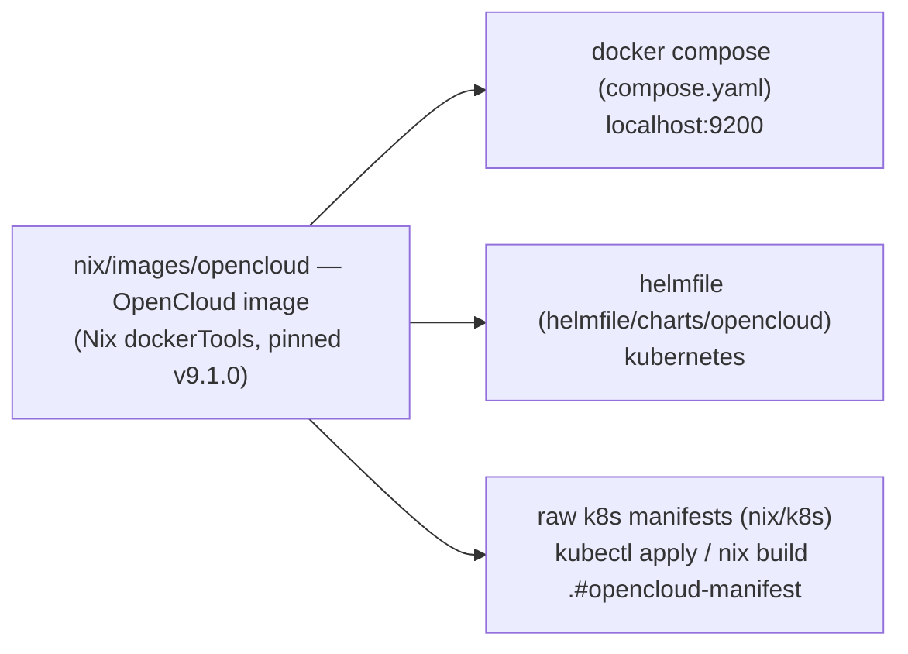

<!--
SPDX-FileCopyrightText: 2026 opencloud-nix Contributors
SPDX-License-Identifier: Apache-2.0
-->

# opencloud-nix — Nix-based OpenCloud deployment (Docker Compose + Helmfile)

Reproducible, Nix-built container image and deployment for
**[OpenCloud](https://opencloud.eu)** — the open-source, vendor-independent file
sync & share successor to ownCloud Infinite Scale.

This repository is a **refactor** of the OpenCloud parts of a large internal
deployment repository: the same Nix image builder, k8s manifest library and
Helm chart patterns, stripped of all environment-specific assumptions
(registry, ingress class, storage classes, DNS, LDAP layout) so they can be
reused as a standalone OpenCloud deployment.

## The three deployment paths

Everything funnels through **one image**: a minimal, layered, non-root
container built by Nix from the pinned upstream release binary.



| Path | Entry point | Best for |
| --- | --- | --- |
| Docker Compose | `make compose-up` | Local dev / single host, Port 9200 |
| Helmfile | `make helmfile-apply` | Kubernetes with git-ops-style value management |
| Raw k8s | `make manifest` / `nix build .#opencloud-manifest` | Plain `kubectl apply` |

## Quick start — Docker Compose

```console
# 1. Build the Nix image and load it into docker (requires nix)
make image-load              # -> image opencloud:9.1.0

# 2. Create ./.env with random secrets (shared with helmfile)
make compose-setup

# 3. Start
make compose-up              # -> http://localhost:9200
```

Log in with the built-in admin user (internal IDM): **`admin` / `admin`**
(password = `idmAdminPassword` / `OPENCLOUD_ADMIN_PASSWORD`). Basic auth
(`PROXY_ENABLE_BASIC_AUTH=true`) works over plain HTTP, so localhost demos
don't need TLS. Note: OpenCloud 9.x does **not** auto-provision the classic
demo users (`einstein`/`relativity`, …) — `IDM_CREATE_DEMO_USERS` has no
effect on a plain `opencloud server` start. Create extra users via the web
UI or the Graph API once admin is logged in.

> `OPENCLOUD_URL` must be an `https://` URL — OpenCloud's internal OIDC
> issuer (idp) refuses `http://` values and the process exits
> ("invalid iss value"). The proxy still listens on plain HTTP, so
> `http://localhost:9200` keeps working for /status.php, the web UI and
> basic-auth logins; only browser OIDC flows expect the https URL.

## Quick start — Helmfile (Kubernetes)

```console
# point helmfile/environments/default/values.yaml at the image you pushed and
# your ingress host, then:
make helmfile-apply          # creates namespace, releases OpenCloud, waits
make helmfile-diff           # dry-run first
make helmfile-template       # render templates without applying
```

Secrets come from `./.env` (`OPENCLOUD_JWT_SECRET`, `OPENCLOUD_TRANSFER_SECRET`,
`OPENCLOUD_MACHINE_AUTH_API_KEY`, `OPENCLOUD_SYSTEM_USER_API_KEY`,
`OPENCLOUD_URL_SIGNING_SECRET`, optional `OPENCLOUD_OIDC_*`). Unset variables
fall back to chart-generated random values (random *per install* — pin them in
productive clusters).

## The Nix image

`nix/images/opencloud/flake.nix` venders the pinned upstream `linux-amd64`
binary (SRI-hashed from the release `.sha256` sidecar) and wraps it in a
minimal layered image:

- one static Go binary, no distro layer; `tini` init, `cacert`, `tzdata`
- runs as **non-root** `1000:1000` (created via fake-root `/etc/passwd`
  entries), `opencloud server` on **9200**
- `OC_CONFIG_DIR=/etc/opencloud` — config is injected at runtime (compose
  mounts `config/`, helm mounts a ConfigMap/Secret)

```console
make image            # nix build .#opencloud-image
make image-push       # skopeo copy -> $REGISTRY/opencloud:$TAG
```

Version bumps: change `version` + `sha256` in the flake (recipe in file
header), `nix flake lock --update-input nixpkgs`.

## Configuration model

Secret-bearing values in `opencloud.yaml` come in two kinds:

- the **five token/machine secrets** (`jwt_secret`, `machine_auth_api_key`,
  `system_user_api_key`, `transfer_secret`, `url_signing_secret`) are stubs
  (`override-via-env`) — the launcher (compose env or the chart's Deployment)
  overrides them via `OC_*` environment variables;
- everything else is the **canonical insecure-demo config** that
  `opencloud init --insecure yes` generates (internal IDM bind passwords,
  service-account secret, WOPI secret, UUIDs). This is intentional so the demo
  works out of the box — regenerate your own config for any real deployment.

This keeps one config shape across all three paths.

- **compose:** `config/opencloud.yaml` → `./config` mount; secrets in `.env`
- **helmfile:** `helmfile/charts/opencloud/templates/configmap.yaml` generates
  the yaml; the `{{name}}-secrets` Secret feeds `OC_*` env vars
- **raw k8s:** `nix/k8s/opencloud.nix` does the same via the Nix `lib`

## Layout

| Path | Purpose |
| --- | --- |
| `nix/images/opencloud/` | Nix flake building the OpenCloud container image |
| `nix/lib/k8s.nix` | Generic k8s manifest builders (refactored) |
| `nix/k8s/opencloud.nix` | OpenCloud k8s manifest (Deployment/ConfigMap/Secret/PVC/Svc/Ingress) |
| `compose.yaml`, `.env.example`, `config/` | Docker Compose deployment (Port 9200) |
| `helmfile/charts/opencloud/` | Helm chart (refactored, generic defaults) |
| `helmfile/` | Helmfile entry point + environment values |
| `Makefile` | All entry points + chart validation |
| `flake.nix` | Root flake: dev shell, image/manifest packages, `apply` app |

## Development

```console
nix develop            # docker, helm, helmfile, kubectl, skopeo, yq, just
make test              # helm lint + helm template + helm-unittest
make yamllint          # yaml style checks
make spellcheck        # cspell on docs
```

## License

Apache-2.0 (see [`LICENSE`](LICENSE)).
